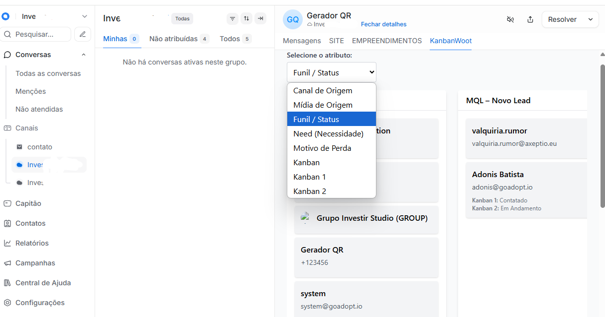

# 🧩 KanbanWoot

Interface web estilo Kanban integrada ao **Chatwoot**, utilizando campos personalizados do tipo lista para visualizar e mover contatos entre etapas diretamente na interface.



## 🚀 Funcionalidades

- 🗂️ Colunas definidas pelos valores de qualquer atributo de contato do tipo lista, mais a coluna "Não definido" para quem não tem valor
- 🏷️ Dropdown para trocar de atributo; o último escolhido fica salvo em cookie
- 📥 Cada coluna busca só os seus contatos no Chatwoot (filtro no servidor), 15 por vez, carregando mais ao rolar; o total aparece no topo da coluna
- 🧲 Arrastar e soltar para mudar o contato de etapa (`@hello-pangea/dnd`), ou pelo menu "Mover para…" do card (teclado e celular)
- 🔎 Busca por nome, telefone ou e-mail e filtro por etiqueta
- ⏱️ Tempo na etapa em cada card, com destaque para os parados há mais de N dias
- ↗️ Link para abrir o contato no Chatwoot
- 🏁 Etapas de ganho e perda com motivo (obrigatório na perda), exibido no card
- 🎯 Dentro do Painel de Aplicativos, destaca o card do contato da conversa aberta
- 💰 Valor do negócio no card e total por coluna
- 📋 Campos obrigatórios por etapa, pedidos num formulário ao mover o card
- 🤖 Automação ao mudar de etapa com n8n (mensagem, nota e etiquetas), com fluxo pronto para importar
- 🔄 Atualização ao vivo: mudanças feitas por outros agentes aparecem sozinhas
- ⚡ Movimentação otimista: o card muda de coluna na hora e volta, com aviso, se a API recusar
- ✅ Filtro opcional pelo atributo `kanbanwoot` para escolher quais contatos entram no board
- 📝 Nomes amigáveis (display name) dos atributos e dos atributos `kbw_*` mostrados nos cards
- 🔐 Login herdado do Chatwoot: publicado no mesmo domínio, usa a sessão do agente já logado (sem 2º login)
- 🔒 Alternativa com token de serviço que fica só no servidor (proxy no nginx)
- 🖇️ Pode ser incorporado ao Chatwoot pelo Painel de Aplicativos

---

## ⚙️ Como funciona

### Atributo do board

O board usa um atributo de contato do tipo **lista**; cada valor da lista vira uma coluna. O atributo é escolhido nesta ordem:

1. Parâmetro `?kbw=<chave_do_atributo>` na URL
2. Cookie `kbw` com o último atributo escolhido no dropdown (ou vindo da URL)
3. Primeiro atributo do tipo lista cuja chave começa com `kbw_`
4. Primeiro atributo do tipo lista

### Colunas

- Cada coluna é buscada separadamente com `POST /contacts/filter` do Chatwoot: `equal_to <valor>` nas etapas e `is_not_present` em "Não definido".
- Mover um card para uma etapa grava o valor no contato; mover para "Não definido" apaga o atributo do contato (`destroy_custom_attributes`).
- Contatos com um valor que **não está na lista** do atributo (ex.: um valor removido da definição) ou com valor vazio não aparecem em nenhuma coluna.

### Filtro `kanbanwoot` (opcional)

Se a conta tiver um atributo de contato com a chave `kanbanwoot` (sugestão: tipo caixa de seleção), **só os contatos com `kanbanwoot` marcado** aparecem no board. Sem esse atributo, todos os contatos entram.

### Busca e filtros

- **Busca**: um só campo. Com `@`, busca no e-mail; só com dígitos (e `+ ( ) - .`), no telefone; senão, no nome. O filtro de contatos do Chatwoot não permite combinar campos com "ou", por isso a busca escolhe um.
- **Etiqueta**: mostra só os contatos com a etiqueta escolhida (etiquetas do contato, não da conversa).
- Agente e caixa de entrada são da conversa, não do contato, e por isso não aparecem como filtro.

### Tempo na etapa

Ao mover um card, o KanbanWoot grava junto a data de entrada na etapa no atributo `<chave_do_atributo>_desde` do contato (ex.: `kbw_funil_desde`). O card mostra há quantos dias está na etapa: em amarelo a partir da metade do limite e em vermelho, com borda, a partir do limite (`KANBANWOOT_STALE_DAYS`, padrão 7 dias). Contatos movidos antes desta versão ficam sem a contagem até a próxima movimentação. Ao mover para "Não definido", os dois atributos são apagados.

### Ganho e perda

Etapas com estes nomes (sem diferenciar maiúsculas) são tratadas como finais:

- **Ganho**: `Ganho`, `Ganhou`, `Vendido`, `Fechado`, `Fechado ganho`, `Won`
- **Perda**: `Perdido`, `Perdeu`, `Fechado perdido`, `Cancelado`, `Lost`

Para usar outros nomes, defina `KANBANWOOT_WON_STAGES` e `KANBANWOOT_LOST_STAGES` (listas separadas por vírgula).

Ao mover um card para uma etapa final, abre um diálogo: na perda o motivo é **obrigatório** (com sugestões de `KANBANWOOT_LOST_REASONS`, mais "Outro…"); no ganho há uma observação opcional. Cancelar não move o card. O motivo fica no atributo `<chave_do_atributo>_motivo` do contato (ex.: `kbw_funil_motivo`) e aparece no card. Ao sair de uma etapa final, o motivo é limpo. Cards em etapas finais não são marcados como parados.

### Contato da conversa aberta

Dentro do Painel de Aplicativos, o KanbanWoot pergunta ao Chatwoot qual contato está na conversa aberta (a cada 2 segundos, porque o Chatwoot não avisa quando o agente troca de conversa). Uma faixa no topo mostra o nome e a etapa do contato, e o card dele ganha destaque e é rolado até ficar visível. Se o card não estiver carregado ou estiver fora dos filtros, a faixa avisa.

As mensagens só são aceitas da página que contém o KanbanWoot e da origem do Chatwoot (a do próprio app no modo `session`; a de `CHATWOOT_PUBLIC_URL` no modo `proxy`). Esse contexto não é assinado pelo Chatwoot e serve só para o destaque, nunca para autenticação.

### Campos obrigatórios por etapa

Defina em `KANBANWOOT_REQUIRED_FIELDS` quais campos precisam estar preenchidos para um contato entrar em cada etapa, no formato `Etapa:campo1,campo2;Outra etapa:campo3`. Por exemplo:

```
KANBANWOOT_REQUIRED_FIELDS=Proposta:kbw_valor,email,kbw_origem;Ganho:kbw_previsao
```

- Campos padrão do contato aceitos: `name`, `email` e `phone_number`. Os demais são chaves de atributos de contato.
- Ao mover um card (arrastando ou pelo menu) para uma etapa com campos faltando, abre um formulário pedindo **só o que falta**, com o tipo de campo do atributo no Chatwoot: número, data, lista, sim/não, link ou texto. Em etapas de ganho/perda, os campos aparecem no mesmo formulário do motivo.
- Os valores vão na mesma gravação da etapa. Se o Chatwoot recusar (ex.: e-mail já usado por outro contato), o card volta e nada é gravado.
- Mover para "Não definido" nunca pede campos. Mudanças feitas fora do KanbanWoot não passam por essa regra.

### Valor do negócio

O valor vem de um atributo de contato (padrão `kbw_valor`, configurável em `KANBANWOOT_VALUE_ATTRIBUTE`), de preferência do tipo número. Também são aceitos textos como `1.500,00`, `R$ 1500` ou `1500.5`. O card mostra o valor formatado (moeda em `KANBANWOOT_CURRENCY`, padrão `BRL`) e cada coluna mostra a soma.

A API do Chatwoot não soma valores, então o total é dos cards **carregados**: enquanto a coluna tiver mais páginas, ele aparece como "parcial: N de M". Ao mover para uma etapa de ganho um contato sem valor, o diálogo oferece um campo opcional para informá-lo.

### Atualização ao vivo

A cada `KANBANWOOT_REFRESH_SECONDS` segundos (padrão 30; `0` desliga), com a aba visível, e sempre que a aba volta a ficar visível, o KanbanWoot rebusca as páginas já carregadas de todas as colunas e troca o board de uma vez. Assim, mudanças feitas por outros agentes ou pelo próprio Chatwoot aparecem sem recarregar a página. O botão "↻ Atualizar" faz isso na hora.

A atualização fica pausada enquanto um card está sendo arrastado ou com o diálogo de ganho/perda aberto, e é descartada se você mover um card ou carregar mais contatos enquanto ela está em andamento. Cada atualização refaz uma busca por página carregada em cada coluna; em boards muito grandes, aumente o intervalo.

### Automação ao mudar de etapa

Para enviar uma mensagem, criar uma nota ou adicionar etiquetas quando o contato entra numa etapa, use o fluxo pronto para o n8n: veja [docs/automacao-n8n.md](docs/automacao-n8n.md).

### Cards

Mostram nome, foto, telefone, e-mail, valor, tempo na etapa, ganho/perda com motivo, link para o contato no Chatwoot e os atributos do contato cuja chave começa com `kbw_`, com o nome amigável de cada um. O menu "Mover para…" leva o card para o topo da coluna escolhida.

---

## 🛠 Tecnologias

- React (com Hooks)
- Tailwind CSS
- Chatwoot API
- @hello-pangea/dnd
- nginx (servidor e proxy no Docker)

---

## 📦 Instalação

Resumo do caminho recomendado:

1. [Prepare o Chatwoot](#1-prepare-o-chatwoot): crie o atributo do funil e anote o ID da conta.
2. [Escolha o modo de acesso](#2-escolha-o-modo-de-acesso): `session` (login do Chatwoot) ou `proxy` (token de serviço).
3. Publique: [no Easypanel](#3-publicar-no-easypanel) ou [com Docker em outro servidor](#-deploy-com-docker).
4. [Coloque o KanbanWoot dentro do Chatwoot](#-como-incorporar-o-kanbanwoot-no-chatwoot-painel-de-aplicativos) (Painel de Aplicativos).

Para mexer no código, veja [Desenvolvimento local](#-desenvolvimento-local).

### 1. Prepare o Chatwoot

1. **Atributo do funil.** No Chatwoot, vá em **Configurações → Atributos personalizados → Adicionar atributo**:
   - **Aplicar a**: Contato
   - **Tipo**: Lista
   - **Chave**: por exemplo `kbw_funil` (chaves que começam com `kbw_` são escolhidas automaticamente)
   - **Valores da lista**: as etapas, na ordem das colunas (ex.: `Novo`, `Proposta`, `Ganho`, `Perdido`)
2. **Atributos opcionais**, conforme o que você for usar:
   - `kbw_valor` (Número): valor do negócio, veja [Valor do negócio](#valor-do-negócio)
   - `kanbanwoot` (Caixa de seleção): limita o board aos contatos marcados, veja [Filtro `kanbanwoot`](#filtro-kanbanwoot-opcional)
   - outros atributos com chave `kbw_...` aparecem nos cards
3. **ID da conta.** É o número na URL do painel: `https://chat.empresa.com/app/accounts/`**`1`**`/dashboard`.
4. **Token** (só no modo `proxy`). Entre com o usuário que o KanbanWoot vai usar e copie o token em **Configurações de Perfil → Token de Acesso**. Prefira um usuário com o mínimo de permissões necessárias.

### 2. Escolha o modo de acesso

| | `session` (recomendado) | `proxy` |
|---|---|---|
| Login | O do próprio Chatwoot, sem segunda tela | Nenhum: quem acessa a URL usa o board |
| Endereço | **No domínio do Chatwoot**, num subcaminho: `https://chat.empresa.com/kanban/` | Qualquer domínio: `https://kanban.empresa.com/` |
| Ações feitas como | Cada agente, com as permissões dele | O usuário dono do token |
| Precisa de token | Não | Sim |

Detalhes de cada modo em [Deploy com Docker](#-deploy-com-docker).

### 3. Publicar no Easypanel

Os passos valem para o Chatwoot instalado no mesmo Easypanel (ex.: pelo template do Chatwoot), com o domínio `chat.empresa.com`. Os nomes dos menus podem variar um pouco entre versões do Easypanel.

**Criar o serviço**

1. No projeto onde está o Chatwoot, clique em **+ Service → App** e dê um nome, por exemplo `kanbanwoot`.
2. Em **Source**, escolha **GitHub** (ou **Git**) e informe o repositório (`pucabala/KanbanWoot` ou o seu fork), a branch `main` e o **Build Path** `/`.
3. Em **Build**, escolha **Dockerfile** (arquivo `Dockerfile`, na raiz). Salve.

**Variáveis de ambiente** (aba **Environment**, como variáveis de execução)

Modo `session`:

```env
KANBANWOOT_AUTH=session
CHATWOOT_ACCOUNT_ID=1
KANBANWOOT_BASE_PATH=/kanban
```

Modo `proxy`:

```env
KANBANWOOT_AUTH=proxy
CHATWOOT_URL=https://chat.empresa.com
CHATWOOT_ACCOUNT_ID=1
CHATWOOT_TOKEN=seu_token_aqui
```

Acrescente as opcionais que quiser (etapas de ganho/perda, campos obrigatórios, valor, intervalo de atualização…). A lista completa está nas tabelas de [Deploy com Docker](#-deploy-com-docker).

**Domínio** (aba **Domains**)

- Modo `session`: adicione um domínio com o **mesmo host do Chatwoot** (`chat.empresa.com`), **caminho** `/kanban` e **porta** `3000`, com HTTPS. O Chatwoot continua respondendo no resto do domínio; o caminho mais específico (`/kanban`) vai para o KanbanWoot.
- Modo `proxy`: adicione um domínio próprio (ex.: `kanban.empresa.com`), caminho `/` e porta `3000`, com HTTPS.

> Com `KANBANWOOT_BASE_PATH=/kanban`, o KanbanWoot funciona tanto se o Easypanel repassar o caminho com o prefixo `/kanban` quanto sem ele. Acesse sempre com a barra final: `https://chat.empresa.com/kanban/`.

**Publicar**

1. Clique em **Deploy** e acompanhe o log do build (a primeira vez leva alguns minutos).
2. Nos logs do serviço deve aparecer `Modo sessão: ...` ou `Modo proxy: ...`. Se aparecer `Erro: variáveis obrigatórias não definidas`, revise a aba Environment.
3. Abra `https://chat.empresa.com/kanban/` (ou o domínio do modo `proxy`). No modo `session`, entre no Chatwoot antes, no mesmo navegador.

**Atualizar**

Para pegar uma versão nova do KanbanWoot, clique em **Deploy** de novo no serviço (ou ative o deploy automático do Easypanel para a branch). Mudanças só nas variáveis de ambiente pedem só um **restart**/redeploy, sem rebuild.

**Segurança no modo `proxy`**

O KanbanWoot não tem login próprio nesse modo. Coloque autenticação na frente (ex.: a autenticação básica do domínio no Easypanel, se a sua versão oferecer, ou um oauth2-proxy) ou prefira o modo `session`.

---

## 🐳 Deploy com Docker

Para qualquer servidor com Docker (no Easypanel, siga o [passo a passo acima](#3-publicar-no-easypanel); as variáveis são as mesmas). O `Dockerfile` incluso faz o build do React e serve os arquivos com nginx na porta 3000. Há dois modos, escolhidos por `KANBANWOOT_AUTH`:

| | `session` (recomendado) | `proxy` (padrão) |
|---|---|---|
| Login | Usa a sessão do agente já logado no Chatwoot | Nenhum: quem acessa a URL usa o board |
| Onde publicar | **No mesmo domínio do Chatwoot**, num subcaminho (ex.: `https://chat.empresa.com/kanban/`) | Qualquer domínio |
| Permissões | As do próprio agente; o Chatwoot registra quem fez cada mudança | As do usuário dono do token de serviço |
| Token no container | Não | Sim (`CHATWOOT_TOKEN`) |

### Modo `session`: login herdado do Chatwoot

O painel do Chatwoot guarda a sessão do agente no cookie `cw_d_session_info`, que o navegador só entrega a páginas do mesmo domínio. Publicado em um subcaminho do Chatwoot, o KanbanWoot lê essa sessão e chama a API do Chatwoot como o próprio agente, do mesmo jeito que o painel do Chatwoot faz. Não há segunda tela de login nem token guardado no KanbanWoot.

- Agente **não logado** no Chatwoot: o KanbanWoot mostra um aviso com link para a tela de login do Chatwoot.
- Agente logado **sem acesso à conta** `CHATWOOT_ACCOUNT_ID`: o board não carrega.
- Logout no Chatwoot encerra o acesso ao KanbanWoot.

```bash
docker build -t kanbanwoot .
docker run -d -p 3000:3000 \
  -e KANBANWOOT_AUTH=session \
  -e CHATWOOT_ACCOUNT_ID=1 \
  -e KANBANWOOT_BASE_PATH=/kanban \
  kanbanwoot
```

Depois, no proxy reverso que atende o domínio do Chatwoot, encaminhe **`/kanban/`** para o container do KanbanWoot e todo o resto para o Chatwoot. Exemplo com nginx:

```nginx
location /kanban/ {
    proxy_pass http://kanbanwoot:3000;   # sem barra no final: o prefixo /kanban é mantido
}
location = /kanban {
    proxy_pass http://kanbanwoot:3000;   # redireciona para /kanban/
}
```

No Traefik ou no Easypanel, use uma regra de caminho `/kanban` no **mesmo domínio** do Chatwoot apontando para o serviço do KanbanWoot.

- `KANBANWOOT_BASE_PATH` deve ser igual ao caminho público quando o proxy **mantém** o prefixo (como no exemplo). Se o seu proxy **remove** o prefixo, deixe a variável vazia e sempre use a URL com a barra final (`/kanban/`).
- O KanbanWoot passa a rodar com os mesmos privilégios de navegador do painel do Chatwoot (mesmo domínio). Só publique assim uma versão do KanbanWoot em que você confia.
- Subdomínios diferentes (ex.: `kanban.empresa.com` e `chat.empresa.com`) **não** funcionam: o cookie do Chatwoot vale só para o host dele.

| Variável | Obrigatória | Descrição |
|---|---|---|
| `KANBANWOOT_AUTH` | sim | `session` |
| `CHATWOOT_ACCOUNT_ID` | sim | ID numérico da conta |
| `KANBANWOOT_BASE_PATH` | não | Subcaminho público, ex.: `/kanban` (veja acima) |
| `KANBANWOOT_STALE_DAYS` | não | Dias na etapa até o card ser marcado como parado (padrão `7`) |
| `KANBANWOOT_WON_STAGES` | não | Nomes das etapas de ganho, separados por vírgula (veja "Ganho e perda") |
| `KANBANWOOT_LOST_STAGES` | não | Nomes das etapas de perda, separados por vírgula |
| `KANBANWOOT_LOST_REASONS` | não | Motivos de perda sugeridos, separados por vírgula |
| `KANBANWOOT_REQUIRED_FIELDS` | não | Campos obrigatórios por etapa, ex.: `Proposta:kbw_valor,email` (veja "Campos obrigatórios por etapa") |
| `KANBANWOOT_VALUE_ATTRIBUTE` | não | Atributo com o valor do negócio (padrão `kbw_valor`) |
| `KANBANWOOT_CURRENCY` | não | Moeda do valor, código ISO 4217 (padrão `BRL`) |
| `KANBANWOOT_REFRESH_SECONDS` | não | Intervalo da atualização ao vivo em segundos (padrão `30`; `0` desliga) |
| `REACT_APP_DEBUG` | não | `true` para logs de debug no console do navegador |

### Modo `proxy`: token de serviço

Para publicar em outro domínio. O nginx funciona como **proxy da API do Chatwoot**: o navegador chama `/chatwoot-api/...` e o nginx repassa para o Chatwoot adicionando o token. Assim o token **nunca chega ao navegador**.

```bash
docker build -t kanbanwoot .
docker run -d -p 3000:3000 \
  -e CHATWOOT_URL=https://app.chatwoot.com \
  -e CHATWOOT_ACCOUNT_ID=1 \
  -e CHATWOOT_TOKEN=seu_token_aqui \
  kanbanwoot
```

| Variável | Obrigatória | Descrição |
|---|---|---|
| `KANBANWOOT_AUTH` | não | `proxy` (padrão) |
| `CHATWOOT_URL` | sim | URL do Chatwoot (sem `/api/...`) |
| `CHATWOOT_ACCOUNT_ID` | sim | ID numérico da conta |
| `CHATWOOT_TOKEN` | sim | Token de acesso de um usuário do Chatwoot |
| `KANBANWOOT_BASE_PATH` | não | Subcaminho público, se houver |
| `CHATWOOT_PUBLIC_URL` | não | URL do Chatwoot vista pelo navegador, para o link "abrir no Chatwoot" (padrão: `CHATWOOT_URL`) |
| `KANBANWOOT_STALE_DAYS` | não | Dias na etapa até o card ser marcado como parado (padrão `7`) |
| `KANBANWOOT_WON_STAGES` | não | Nomes das etapas de ganho, separados por vírgula (veja "Ganho e perda") |
| `KANBANWOOT_LOST_STAGES` | não | Nomes das etapas de perda, separados por vírgula |
| `KANBANWOOT_LOST_REASONS` | não | Motivos de perda sugeridos, separados por vírgula |
| `KANBANWOOT_REQUIRED_FIELDS` | não | Campos obrigatórios por etapa, ex.: `Proposta:kbw_valor,email` (veja "Campos obrigatórios por etapa") |
| `KANBANWOOT_VALUE_ATTRIBUTE` | não | Atributo com o valor do negócio (padrão `kbw_valor`) |
| `KANBANWOOT_CURRENCY` | não | Moeda do valor, código ISO 4217 (padrão `BRL`) |
| `KANBANWOOT_REFRESH_SECONDS` | não | Intervalo da atualização ao vivo em segundos (padrão `30`; `0` desliga) |
| `REACT_APP_DEBUG` | não | `true` para logs de debug no console do navegador |

Os nomes antigos (`REACT_APP_CHATWOOT_URL`, `REACT_APP_CHATWOOT_ACCOUNT_ID`, `REACT_APP_CHATWOOT_TOKEN`) continuam aceitos.

O proxy libera apenas o que o KanbanWoot usa: filtrar contatos por coluna, listar etiquetas, listar definições de atributos, atualizar um contato e remover atributos de um contato. Qualquer outra rota ou método em `/chatwoot-api/` responde `403`.

> ⚠️ **Neste modo o KanbanWoot não tem login.** Quem acessar a URL dele pode ver e alterar contatos usando o token configurado. Publique-o só em uma rede ou domínio restrito, ou coloque autenticação na frente (ex.: oauth2-proxy ou a autenticação do Easypanel). Prefira o token de um usuário com permissões mínimas. Se puder publicar no domínio do Chatwoot, prefira o modo `session`.

---

## 💻 Desenvolvimento local

Requer Node.js 18 ou mais novo ([nodejs.org](https://nodejs.org/)).

```bash
git clone https://github.com/pucabala/KanbanWoot.git
cd KanbanWoot
npm install
cp .env.example .env    # depois preencha com os dados do seu Chatwoot
npm start               # abre em http://localhost:3000
```

O `.env` não é versionado (está no `.gitignore`). Variáveis principais:

```env
REACT_APP_CHATWOOT_TOKEN=seu_token_aqui
REACT_APP_CHATWOOT_ACCOUNT_ID=1
REACT_APP_CHATWOOT_URL=https://app.chatwoot.com
REACT_APP_DEBUG=false
```

As demais opções (etapas de ganho/perda, campos obrigatórios, valor, atualização ao vivo) estão comentadas no `.env.example`, com os mesmos nomes das variáveis do Docker trocando `KANBANWOOT_` por `REACT_APP_`.

> Neste modo o token vai para o navegador: use só para desenvolvimento. `REACT_APP_DEBUG=true` liga os logs `[DEBUG]` no console.

### CORS no Chatwoot (só para desenvolvimento local)

Com o Docker não há CORS: o navegador só fala com o próprio domínio. Já no `npm start` o navegador chama o Chatwoot direto, de outro endereço, e o Chatwoot precisa liberar essa origem.

Crie o arquivo `/app/config/initializers/cors.rb` no container do Chatwoot (no Easypanel, use uma montagem de arquivo em **Mounts** para ele não sumir ao reiniciar) e reinicie o Chatwoot:

```ruby
Rails.application.config.middleware.insert_before 0, Rack::Cors do
  allow do
    origins 'http://localhost:3000'

    resource '*',
      headers: :any,
      methods: [:get, :post, :put, :patch, :delete, :options, :head]
  end
end
```

Troque `origins` pelo endereço de onde você roda o KanbanWoot. Não use `*`.

---

## 🖇️ Como incorporar o KanbanWoot no Chatwoot (Painel de Aplicativos)

Você pode exibir o KanbanWoot diretamente no painel lateral do Chatwoot para que os agentes tenham acesso rápido ao funil de contatos.

**Passo a passo:**

1. No Chatwoot, acesse:
   - **Configurações** > **Integrações** > **Painel de Aplicativos**
2. Clique em **Adicionar um novo aplicativo**.
3. Preencha os campos:
   - **Nome:** KanbanWoot
   - **Endpoint:** `https://chat.empresa.com/kanban/?kbw=kbw_funil` (modo `session`) ou `https://meu_kanbanwoot.com/?kbw=kbw_funil` (modo `proxy`)
     - Substitua pelo endereço real do seu KanbanWoot e pela chave do atributo de lista desejado (ex.: `kbw_funil`).
     - Use o `?kbw=` no endpoint: dentro do iframe, alguns navegadores (ex.: Safari) bloqueiam o cookie que guarda o último atributo escolhido.
4. Salve. O KanbanWoot aparecerá como um painel lateral dentro do Chatwoot, fornecendo contexto visual e permitindo movimentação dos contatos sem sair do atendimento.

> O Painel de Aplicativos permite incorporar aplicações externas para fornecer informações adicionais ao agente, como histórico, pedidos ou status personalizado do cliente.

---

## 🩺 Solução de problemas

| Sintoma | Causa provável e solução |
|---|---|
| Container não sobe; log com `Erro: variáveis obrigatórias não definidas` | Falta variável do modo escolhido. `session`: `CHATWOOT_ACCOUNT_ID`. `proxy`: `CHATWOOT_URL`, `CHATWOOT_TOKEN` e `CHATWOOT_ACCOUNT_ID`. |
| "Você não está logado no Chatwoot" (modo `session`) | Entre no Chatwoot no mesmo navegador e recarregue. Se continuar, confira se o KanbanWoot está no **mesmo host** do Chatwoot (`chat.empresa.com/kanban/`, não `kanban.empresa.com`). |
| "Seu usuário do Chatwoot não tem acesso à conta N" | `CHATWOOT_ACCOUNT_ID` não é uma conta do agente logado. Confira o número na URL do painel do Chatwoot. |
| Página em branco ou sem estilo em `/kanban` | Acesse com a barra final (`/kanban/`) e confira `KANBANWOOT_BASE_PATH=/kanban`. |
| "Nenhum atributo customizado do tipo lista encontrado" | Crie o atributo de contato do tipo **Lista** (passo 1) e confira se ele tem valores. |
| Colunas vazias, mas há contatos | Contatos com valor fora da lista ou vazio não aparecem. Se existir o atributo `kanbanwoot`, só os contatos marcados com ele entram. |
| Erro ao mover card / `401` ou `403` (modo `proxy`) | Token inválido ou sem permissão; gere outro em Configurações de Perfil → Token de Acesso e atualize `CHATWOOT_TOKEN`. |
| Erro de CORS no console (`npm start`) | Libere a origem no Chatwoot, veja [CORS no Chatwoot](#cors-no-chatwoot-só-para-desenvolvimento-local). |
| `npm: command not found` / `'npm' não é reconhecido` | Instale o Node.js 18+ e reabra o terminal. |
| Mudou uma variável e nada mudou | As variáveis são lidas ao iniciar o container: faça restart/redeploy. No `npm start`, pare e rode de novo. |

---

## 🔧 Melhorias futuras

- Relatórios de funil (conversão, tempo médio por etapa, ganhos/perdas por motivo), com histórico de movimentações
- Mais de um negócio por contato (oportunidades)
- Filtros por agente e caixa de entrada (dados da conversa, não do contato)
